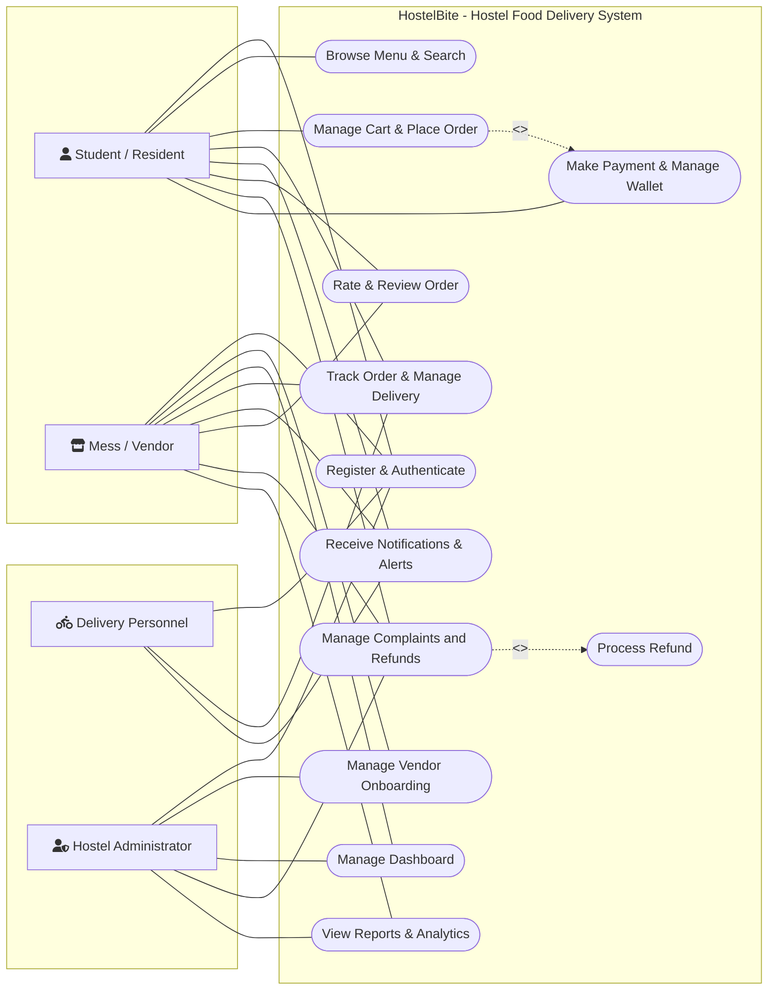

# Experiment 2: Use Case Diagram
## HostelBite — Hostel Food Delivery Application

**Course**: B.Tech Information Technology, 5th Semester  
**Subject**: Software Engineering Laboratory (AY 2026–27)  
**Institution**: Manipal University Jaipur  
**Authors**: Saharsh Vaibhav Lal & Vaibhav Kumar (5F Batch-1)  

---

### 1. Diagram Description
The Use Case diagram specifies the system boundaries of **HostelBite** and illustrates the functional interactions between the four primary actors and the platform use cases.

#### Primary Actors:
1. **Student / Resident**: End-user placing food orders, managing prepaid hostel wallet, tracking deliveries, and submitting ratings or complaints.
2. **Mess / Vendor**: Food vendor or mess manager onboarding their outlet, curating daily menus, managing incoming orders, and fulfilling deliveries.
3. **Delivery Personnel**: Student runners or campus couriers claiming ready orders, delivering items to designated hostel blocks, and confirming hand-off.
4. **Hostel Administrator**: Supervisory authority approving vendors, resolving disputes, auditing transactions, and reviewing campus dining analytics.

---

### 2. Mermaid Use Case Diagram

---

### 3. Use Case Specifications & Mapping

| Use Case Name | Participating Actors | Preconditions | Description & Key Steps | Related Modules |
|---|---|---|---|---|
| **Register & Authenticate** | Student, Vendor, Delivery, Admin | Valid university credentials or vendor application | Handles user registration, role assignment, OTP verification, and secure JWT login. | Auth Service (`/api/auth`) |
| **Browse Menu & Search** | Student | User logged in | Fetches active daily menus and campus eateries. Supports dietary filters (Veg/Non-Veg/Jain), search, and item pricing. | Menu Service (`/api/menu`, `/api/vendors`) |
| **Manage Cart & Place Order** | Student | Items available in stock | Adds items to cart from a single vendor, verifies minimum order value, selects delivery slot and hostel room, and proceeds to checkout. | Cart & Order Service (`/api/orders`) |
| **Make Payment & Manage Wallet** | Student | Active order in pending state | Processes cashless payment via UPI, Card, or in-app prepaid wallet. Supports wallet top-up and balance checks. | Payment Service (`/api/payments`, `/api/wallet`) |
| **Track Order & Manage Delivery** | Student, Vendor, Delivery Personnel | Order confirmed as paid | Displays live 6-stage lifecycle stepper: `Placed` → `Accepted` → `Preparing` → `Ready` → `Out for Delivery` → `Delivered`. | Delivery & Order Tracker (`/api/orders`, `/api/delivery`) |
| **Manage Complaints & Refunds** | Student, Vendor, Administrator | Order delivered within 12 hours | Student raises an issue (damaged, delayed, missing). Vendor reviews, or Admin intervenes and authorizes wallet refunds. | Complaint Service (`/api/complaints`) |
| **Rate & Review Order** | Student, Vendor | Order delivered | Student provides 1–5 star rating and comment; vendor provides single official response. | Review Service (`/api/reviews`) |
| **Manage Vendor Onboarding** | Vendor, Administrator | Vendor application submitted | Collects FSSAI license, business proof, cuisine category; Admin approves or rejects. | Vendor Management (`/api/admin/vendors`) |
| **View Reports & Analytics** | Vendor, Administrator | Authorized role | Analyzes order volume, mess wastage projections, sales revenue, and delivery turnaround times. | Analytics Service (`/api/admin/analytics`) |
