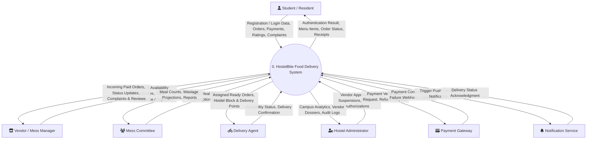
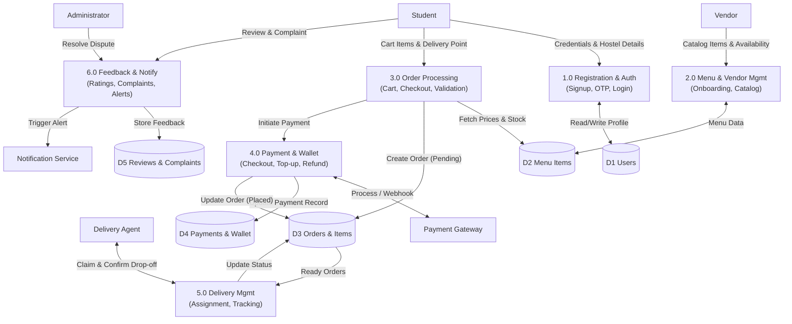
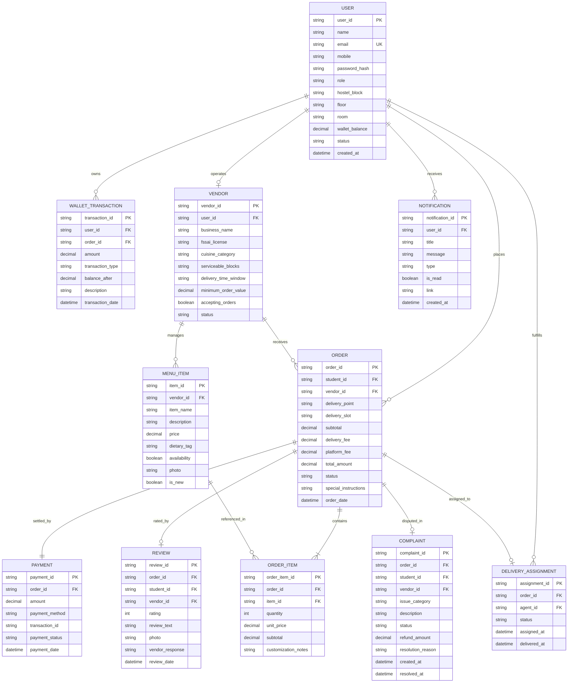

# Experiment 3: Data Flow Diagrams (DFD) and Entity-Relationship Diagram (ERD)
## HostelBite — Hostel Food Delivery Application

**Course**: B.Tech Information Technology, 5th Semester  
**Subject**: Software Engineering Laboratory (AY 2026–27)  
**Institution**: Manipal University Jaipur  
**Authors**: Saharsh Vaibhav Lal & Vaibhav Kumar (5F Batch-1)  

---

### 1. Data Flow Diagrams

#### 1.1 Context-Level DFD (Level 0)
The Level 0 Context DFD represents the fundamental data boundary of HostelBite, showing incoming and outgoing data flows between external entities and the central application process.

---

#### 1.2 Level 1 DFD
The Level 1 DFD decomposes the central system into six core functional sub-processes and five persistent data stores.

---

### 2. Entity-Relationship Diagram (ERD)

The conceptual schema encompasses the eight core entities from the approved class diagram alongside supporting entities (`WALLET_TRANSACTION`, `DELIVERY_ASSIGNMENT`, `NOTIFICATION`).

