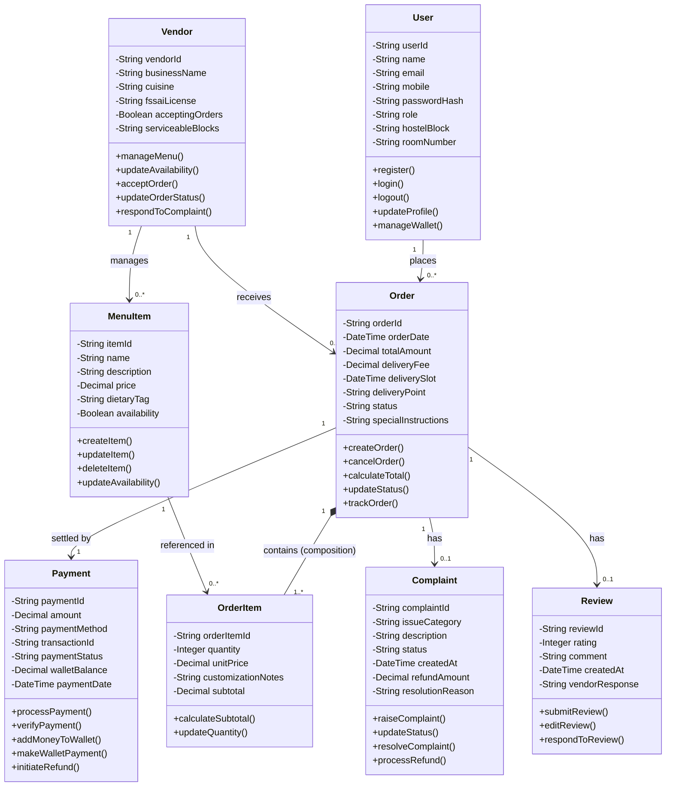

# Experiment 4: Class Diagram
## HostelBite — Hostel Food Delivery Application

**Course**: B.Tech Information Technology, 5th Semester  
**Subject**: Software Engineering Laboratory (AY 2026–27)  
**Institution**: Manipal University Jaipur  
**Authors**: Saharsh Vaibhav Lal & Vaibhav Kumar (5F Batch-1)  

---

### 1. Conceptual Model & Core Classes
The class diagram models the structural relationships and object-oriented representation of the HostelBite system. In strict adherence to the approved project specification (`ClassDiagram1.jpg`), the system centers upon **eight core conceptual classes**:

1. **User**: Represents all platform actors (Student, Vendor, Delivery, Admin) with attributes for identity, contact, role, hostel room, and authentication.
2. **Vendor**: Represents an empaneled campus eatery or central mess facility with operating parameters and serviceable blocks.
3. **MenuItem**: Represents a culinary offering associated with a vendor, detailing pricing, dietary tag, and real-time availability.
4. **Order**: Represents a food order placed by a student to a vendor, encapsulating pricing breakdown, status, slot, and delivery point.
5. **OrderItem**: Represents an individual item line in an order, preserving the unit price charged at checkout and quantity.
6. **Payment**: Represents the financial transaction settling an order via UPI, card, or prepaid hostel wallet.
7. **Complaint**: Encapsulates post-delivery issue raising, dispute resolution, and refund processing.
8. **Review**: Encapsulates 1–5 star rating feedback, customer comments, and vendor responses.

---

### 2. Mermaid Class Diagram

---

### 3. Multiplicity & Design Rationale

1. **User (1) to Order (0..*)**: A student user can place zero or multiple orders over time. Each order is strictly associated with exactly one student.
2. **Vendor (1) to Order (0..*)**: A vendor receives multiple orders. Every order is fulfilled by exactly one vendor (single-vendor cart rule).
3. **Vendor (1) to MenuItem (0..*)**: A vendor manages a catalog of menu items. Each item belongs to a specific vendor.
4. **Order (1) to OrderItem (1..*) [Composition]**: An order cannot exist without at least one item line. OrderItems have no independent existence outside their parent order; deleting or canceling an order cascades to its items.
5. **MenuItem (1) to OrderItem (0..*)**: A menu item can be ordered multiple times across different orders. The `OrderItem` stores the historical `unitPrice` charged at that moment, insulating completed order receipts from future catalog price alterations.
6. **Order (1) to Payment (1)**: Each order is settled by one valid payment record. In the simplified transaction model, payments are processed atomically at checkout.
7. **Order (1) to Complaint (0..1)**: To prevent duplicate threads and frivolous disputes, a customer may lodge at most one formal complaint per eligible order.
8. **Order (1) to Review (0..1)**: Each delivered order permits at most one verified review and rating.
