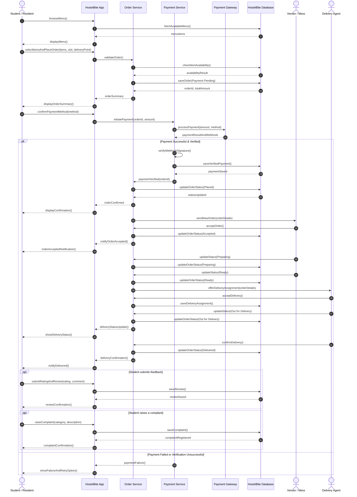

# Experiment 5: Sequence Diagram
## HostelBite — Hostel Food Delivery Application

**Course**: B.Tech Information Technology, 5th Semester  
**Subject**: Software Engineering Laboratory (AY 2026–27)  
**Institution**: Manipal University Jaipur  
**Authors**: Saharsh Vaibhav Lal & Vaibhav Kumar (5F Batch-1)  

---

### 1. Diagram Description
The sequence diagram details the end-to-end procedural workflow of placing, paying, preparing, delivering, and rating an order. It models interactions between:
- `Student / Resident`
- `HostelBite App` (Frontend Client)
- `Order Service` (Backend API)
- `Payment Service` (Backend API)
- `Payment Gateway` (Simulated Gateway Service)
- `HostelBite Database` (Persistent SQLite Store)
- `Vendor / Mess` (Kitchen Dashboard)
- `Delivery Agent` (Delivery Interface)

---

### 2. Mermaid Sequence Diagram

---

### 3. Safety & Transactional Flow Analysis
In academic UML documentation, some preliminary diagrams occasionally depict notifying the kitchen prior to payment verification. However, in our production-ready implementation, **HostelBite enforces strict financial safety**:
1. The order is initially persisted with `Payment Pending` status.
2. The payment transaction is processed and verified against the simulated gateway.
3. Only when payment is confirmed does the order transition to `Placed`, at which point it becomes visible on the Vendor Dashboard.
4. If payment fails, the order is flagged `Payment Failed` and is never dispatched to the kitchen queue, preventing kitchen inventory losses.
