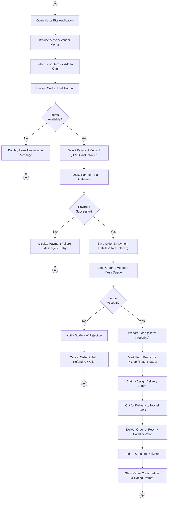
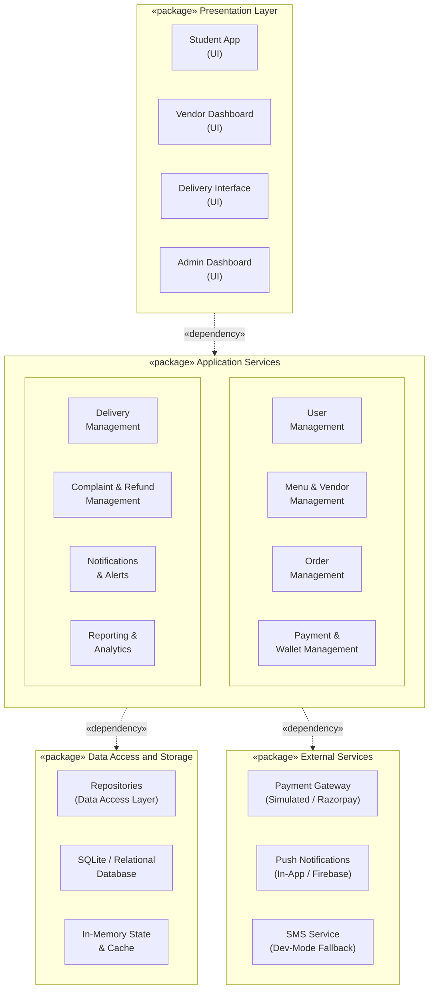

# Experiment 6: Activity and Package Diagrams
## HostelBite — Hostel Food Delivery Application

**Course**: B.Tech Information Technology, 5th Semester  
**Subject**: Software Engineering Laboratory (AY 2026–27)  
**Institution**: Manipal University Jaipur  
**Authors**: Saharsh Vaibhav Lal & Vaibhav Kumar (5F Batch-1)  

---

### 1. Activity Diagram: Food Ordering Process
The Activity diagram models the control flow through user actions, decisions, and system validations from application launch to delivery hand-off and feedback.

---

### 2. Package Diagram: System Architecture
The Package diagram illustrates the tiered modular organization and layer dependencies across the system.

---

### 3. Layer Responsibilities
- **Presentation Layer**: Built with React, TypeScript, and Vite. Implements clean, responsive student menus, kitchen Kanban boards, courier task lists, and administrative oversight consoles.
- **Application Services Layer**: Built with Node.js and Express.js. Contains domain logic, order lifecycle state validations, cart price recalculations, and role authorization middlewares.
- **Data Access and Storage Layer**: Uses SQLite with strict foreign keys and transactional operations to safeguard order, payment, and wallet ledgers.
- **External Services**: Encapsulates external communications (payment verification simulation and notifications).
