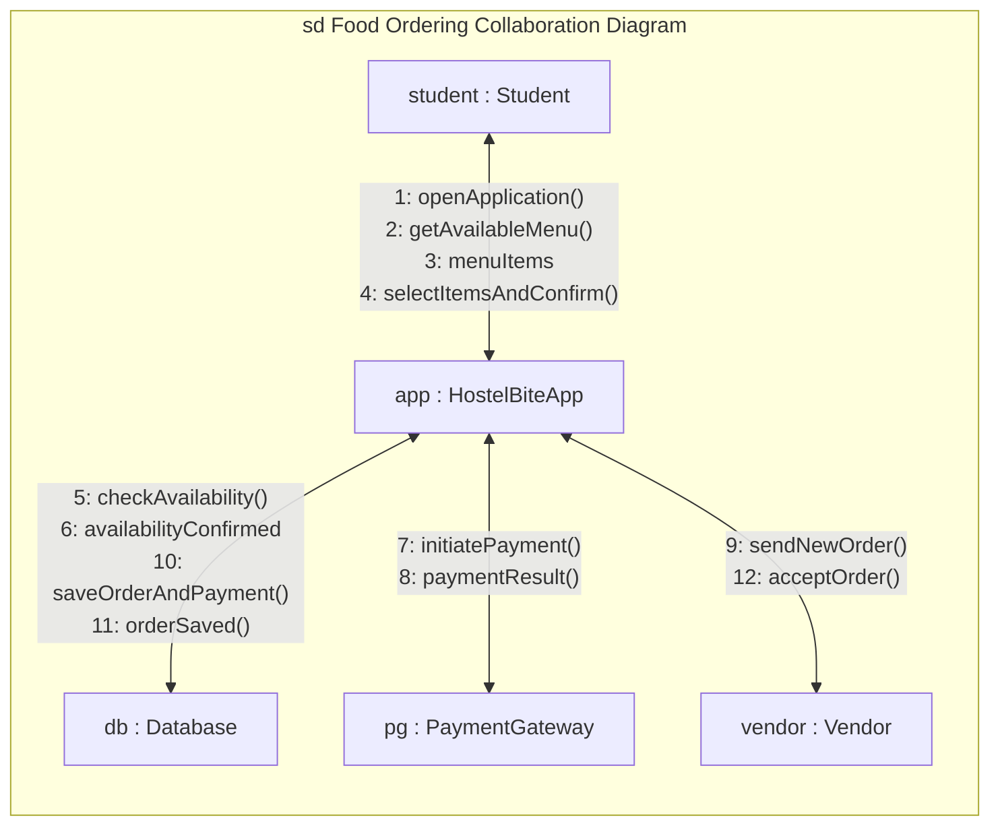

# Experiment 7: Collaboration (Communication) Diagram
## HostelBite — Hostel Food Delivery Application

**Course**: B.Tech Information Technology, 5th Semester  
**Subject**: Software Engineering Laboratory (AY 2026–27)  
**Institution**: Manipal University Jaipur  
**Authors**: Saharsh Vaibhav Lal & Vaibhav Kumar (5F Batch-1)  

---

### 1. Diagram Description
The Collaboration (Communication) Diagram illustrates structural object collaborations and the numbered sequence of messages passed during a food ordering transaction.

#### Participating Objects:
- `student : Student` — Resident ordering food.
- `app : HostelBiteApp` — Frontend and API Application Coordinator.
- `db : Database` — Persistent data store for menus, orders, and payments.
- `pg : PaymentGateway` — Gateway interface processing digital payment.
- `vendor : Vendor` — Campus eatery or mess receiving kitchen tickets.

---

### 2. Mermaid Collaboration Diagram

---

### 3. Numbered Message Sequence Table

| Message No. | Message Call | Sender | Receiver | Description |
|---|---|---|---|---|
| **1** | `openApplication()` | `student` | `app` | Student launches the HostelBite web application and authenticates. |
| **2** | `getAvailableMenu()` | `student` | `app` | Student opens the menu catalog to browse today's mess items and vendors. |
| **3** | `menuItems` | `app` | `student` | System returns filtered, priced, and categorized food items. |
| **4** | `selectItemsAndConfirm()` | `student` | `app` | Student selects dishes, specifies hostel block/room, and clicks checkout. |
| **5** | `checkAvailability()` | `app` | `db` | Application verifies that all requested items are in stock. |
| **6** | `availabilityConfirmed` | `db` | `app` | Database confirms items are currently active and available. |
| **7** | `initiatePayment()` | `app` | `pg` | App invokes payment gateway modal with recalculated server total. |
| **8** | `paymentResult()` | `pg` | `app` | Payment gateway confirms successful transaction verification. |
| **9** | `sendNewOrder()` | `app` | `vendor` | App transmits confirmed order ticket to the vendor's active order board. |
| **10** | `saveOrderAndPayment()` | `app` | `db` | App commits paid order, order items, and payment transaction record. |
| **11** | `orderSaved()` | `db` | `app` | Database returns confirmation of atomic commit. |
| **12** | `acceptOrder()` | `vendor` | `app` | Vendor accepts the order and moves status to `Accepted` / `Preparing`. |

---

### 4. Sequence vs. Collaboration Consistency Note
Both Experiment 5 (Sequence Diagram) and Experiment 7 (Collaboration Diagram) model the identical food ordering and fulfillment lifecycle:
- In both diagrams, items are validated before payment.
- In both diagrams, payment authorization is verified prior to dispatching the order to the kitchen queue.
- This prevents kitchen inventory loss from unpaid or abandoned carts.
